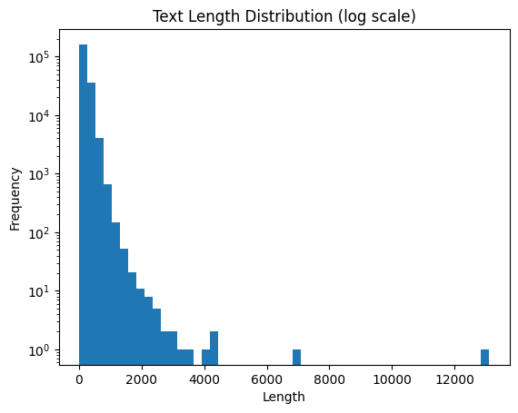

This post details the full pipeline for fine-tuning a Large Language Model (LLM) using the Hugging Face library and PEFT (LoRA) technique to build and evaluate a binary classification model that distinguishes between human-written and AI-generated text.

<!--more-->

## 1. Environment Setup & Installation

Import essential libraries for model training and data processing, and install key packages required for resource-efficient fine-tuning.

- **Key Packages**: `transformers`, `peft`, `bitsandbytes`, `datasets`, `accelerate`, etc.
- Set up the environment for low-cost, high-efficiency training with 4-bit quantization.

```python
import os
import warnings
import pandas as pd
import torch
import numpy as np

!pip -qq install peft
!pip -qq install bitsandbytes
!pip -qq install GPUtil
!pip -qq install transformers==4.43.1
!pip -qq install transformers accelerate sentencepiece
!pip -qq install accelerate==0.34.2
!pip -qq install torch
!pip -qq install langdetect
```

<br>

## 2. Configuration

Set a fixed random seed to ensure reproducibility, and define the hyperparameters and directory paths used for model training.

```python
from transformers import set_seed

SEED = 123
set_seed(SEED)

warnings.filterwarnings('ignore')
os.environ["TOKENIZERS_PARALLELISM"] = "false"

INPUT_DIR = '/kaggle/input/2025-sw-digital-competition-datasets'
DIR = '/kaggle/working/'
NUM_WORKERS = os.cpu_count()
NUM_CLASSES = 2

EPOCHS, R, LORA_ALPHA, LORA_DROPOUT = 1, 64, 32, 0.3
BATCH_SIZE = 6
MODEL_ID = '/kaggle/input/llama-2/pytorch/7b-hf/1'
```

<br>

## 3. Data Processing & Preparation (Data Processing)

Load the human-written text data and AI-generated text data, filter them based on labels, and reconstruct them into a DatasetDict format.

- Data Loading & Filtering: Combine Human data (label == 0) and AI data (label == 1, generated >= 0.6).
- Dataset Shuffling: Construct training and test sets using concatenate_datasets and shuffle.

```python
from datasets import load_dataset, concatenate_datasets, DatasetDict

# 1. Load Datasets
dataset_53 = load_dataset('csv', data_files='/kaggle/input/digital-competition-no-train-dataset/non_train_human_token.csv')
dataset_ai = load_dataset('csv', data_files='/kaggle/input/digital-competition-no-train-dataset/top20000_ai_like_sentences (1).csv')

# 2. Filter by Label & Clean Columns
human_data = dataset_53['train'].filter(lambda x: x['label'] == 0)
ai_data = dataset_ai['train'].filter(lambda x: x['label'] == 1)
ai_data_filtered_by_generated = ai_data.filter(lambda x: x['generated'] >= 0.6)

human_data = human_data.remove_columns(['text_length', 'token_count', 'token_bin'])
ai_data_filtered_by_generated = ai_data_filtered_by_generated.remove_columns(['generated'])

# 3. Concatenate and Split Dataset
combined_dataset = concatenate_datasets([human_data, ai_data_filtered_by_generated]).shuffle(seed=42)
test_dataset = combined_dataset.select(range(2000))

dataset = DatasetDict({
    'train': combined_dataset,
    'test' : test_dataset
})
```

<br>

## 4. Tokenization

Load AutoTokenizer supporting multilingual processing, set the padding token, and tokenize the input text sequences.

```python
from transformers import AutoTokenizer

tokenizer = AutoTokenizer.from_pretrained(MODEL_ID)
tokenizer.pad_token = tokenizer.eos_token

tokenized_dataset = {}
MAX_LENGTH = 512

for split in dataset.keys():
    tokenized_dataset[split] = dataset[split].map(
        lambda x: tokenizer(x["text"], truncation=True, max_length=MAX_LENGTH), batched=True
    )
```

<br>

## 5. Model Loading & LoRA Setup

Apply 4-bit quantization (BitsAndBytesConfig) to save GPU memory, and load the AutoModelForSequenceClassification model. Then, configure PEFT (LoraConfig) for efficient parameter fine-tuning.

```python
from transformers import AutoModelForSequenceClassification, BitsAndBytesConfig
from peft import prepare_model_for_kbit_training, LoraConfig, TaskType, get_peft_model

# 4-bit Quantization Config
quant_config = BitsAndBytesConfig(load_in_4bit=True)

model = AutoModelForSequenceClassification.from_pretrained(
    MODEL_ID,
    num_labels=NUM_CLASSES,
    quantization_config=quant_config,
    device_map="auto"
)
model.config.pad_token_id = model.config.eos_token_id

# Prepare k-bit Training & LoRA Config
model = prepare_model_for_kbit_training(model)

lora_config = LoraConfig(
    r=R,
    lora_alpha=LORA_ALPHA,
    lora_dropout=LORA_DROPOUT,
    task_type=TaskType.SEQ_CLS,
    target_modules='all-linear'
)

lora_model = get_peft_model(model, lora_config)
lora_model.print_trainable_parameters()
```

<br>

## 6. Model Training

Define a custom trainer (SoftLabelTrainer) to handle Soft Labels and Binary Cross-Entropy (BCE) loss, then execute the training procedure.

```python
from transformers import Trainer, TrainingArguments, DataCollatorWithPadding
import torch.nn.functional as F

def compute_metrics(eval_pred):
    predictions, labels = eval_pred
    predictions = np.argmax(predictions, axis=1)
    return {"accuracy": (predictions == labels).mean()}

class SoftLabelTrainer(Trainer):
    def compute_loss(self, model, inputs, return_outputs=False):
        labels = inputs.pop("labels")
        outputs = model(**inputs)
        logits = outputs.logits
        
        probs = torch.softmax(logits, dim=-1)
        ai_probs = probs[:, 1]  # "AI일 확률"
        
        loss = F.binary_cross_entropy(ai_probs, labels.float())
        return (loss, outputs) if return_outputs else loss

trainer = SoftLabelTrainer(
    model=lora_model,
    args=TrainingArguments(
        output_dir="./data/",
        learning_rate=2e-5,
        per_device_train_batch_size=BATCH_SIZE,
        per_device_eval_batch_size=BATCH_SIZE,
        evaluation_strategy="epoch",
        save_strategy="epoch",
        num_train_epochs=EPOCHS,
        weight_decay=0.01,
        load_best_model_at_end=True,
        logging_steps=10,
        report_to="none",
        fp16=True
    ),
    train_dataset=tokenized_dataset["train"],
    eval_dataset=tokenized_dataset["test"],
    tokenizer=tokenizer,
    data_collator=DataCollatorWithPadding(tokenizer=tokenizer),
    compute_metrics=compute_metrics,
)

# Start Training
trainer.train()
```

<br>

## 7. Inference & Submission File Generation (Prediction & Submission)

Run inference on the test dataset (test_df) using the fine-tuned model, and generate the final submission.csv file.

```python
from tqdm import tqdm

predictions = []

for text in tqdm(test_df['paragraph_text'].values):
    prediction = clf(text)
    score = prediction[0]['score']
    label = prediction[0]['label']
    
    if label == 'LABEL_0':
        score = 1 - score  # 확률 보정
        
    predictions.append(score)

sample_submission['generated'] = predictions
sample_submission.to_csv('submission.csv', index=False)
```

## 8. Key Takeaways from Preparing for This Competition

- Full fine-tuning of Large Language Models is extremely resource-intensive and often impractical. However, leveraging LoRA alongside 4-bit quantization (BitsAndBytes) allows for highly effective training performance even within constrained GPU environments.

- Data accumulated throughout a competition may prove valuable in unexpected ways later on. For instance, hard-voting and soft-voting ensemble strategies require different prediction formats, making it crucial to log all generated inference outputs.


- Conducting thorough Exploratory Data Analysis (EDA) at the beginning is the first step toward achieving top leaderboard scores, as initial raw datasets frequently contain noise. In fine-tuning tasks, analyzing text length, tokenized length distributions, and semantic domain characteristics during EDA is highly recommended before modeling.