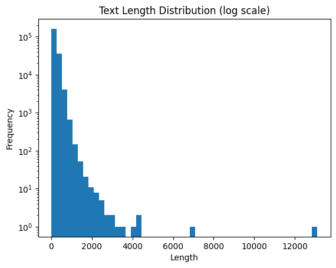

Hugging Face 라이브러리와 PEFT(LoRA) 기법을 활용하여 대형 언어 모델(LLM)을 파인튜닝하고, 텍스트가 인간이 작성한 것인지 AI가 생성한 것인지 판별하는 이진 분류 모델을 구축 및 추론하는 전 과정을 정리한 글입니다.

<!--more-->

## 1. 환경 설정 및 라이브러리 설치 (Import and Install)

모델 학습과 데이터 처리에 필요한 주요 라이브러리를 임포트하고, 효율적인 파인튜닝을 위한 패키지들을 설치합니다.

- **주요 패키지**: `transformers`, `peft`, `bitsandbytes`, `datasets`, `accelerate` 등
- 4-bit 양자화 및 저비용 고효율 학습을 위한 환경을 준비합니다.

```python
import os
import warnings
import pandas as pd
import torch
import numpy as np

!pip -qq install peft
!pip -qq install bitsandbytes
!pip -qq install GPUtil
!pip -qq install transformers==4.43.1
!pip -qq install transformers accelerate sentencepiece
!pip -qq install accelerate==0.34.2
!pip -qq install torch
!pip -qq install langdetect
```

<br>

## 2. 세부 설정 (Configure)

재현성(Reproducibility)을 확보하기 위해 고정 시드(Seed)를 설정하고, 모델 학습에 사용할 하이퍼파라미터와 경로를 지정합니다.

```python
from transformers import set_seed

SEED = 123
set_seed(SEED)

warnings.filterwarnings('ignore')
os.environ["TOKENIZERS_PARALLELISM"] = "false"

INPUT_DIR = '/kaggle/input/2025-sw-digital-competition-datasets'
DIR = '/kaggle/working/'
NUM_WORKERS = os.cpu_count()
NUM_CLASSES = 2

EPOCHS, R, LORA_ALPHA, LORA_DROPOUT = 1, 64, 32, 0.3
BATCH_SIZE = 6
MODEL_ID = '/kaggle/input/llama-2/pytorch/7b-hf/1'
```

<br>

## 3. 데이터 전처리 및 구성 (Data Processing)

인간이 작성한 텍스트 데이터와 AI가 생성한 텍스트 데이터를 각각 불러와 라벨 기준으로 필터링하고, DatasetDict 형태로 재구성합니다.

- 데이터 로드 및 필터링: Human 데이터(label == 0)와 AI 데이터(label == 1, generated >= 0.6)를 결합
- 데이터셋 셔플: concatenate_datasets와 shuffle을 통해 학습 및 테스트 셋 구성

```python
from datasets import load_dataset, concatenate_datasets, DatasetDict

# 1. 데이터 로드
dataset_53 = load_dataset('csv', data_files='/kaggle/input/digital-competition-no-train-dataset/non_train_human_token.csv')
dataset_ai = load_dataset('csv', data_files='/kaggle/input/digital-competition-no-train-dataset/top20000_ai_like_sentences (1).csv')

# 2. 라벨 기준 필터링 및 컬럼 정리
human_data = dataset_53['train'].filter(lambda x: x['label'] == 0)
ai_data = dataset_ai['train'].filter(lambda x: x['label'] == 1)
ai_data_filtered_by_generated = ai_data.filter(lambda x: x['generated'] >= 0.6)

human_data = human_data.remove_columns(['text_length', 'token_count', 'token_bin'])
ai_data_filtered_by_generated = ai_data_filtered_by_generated.remove_columns(['generated'])

# 3. 데이터 합치기 및 쪼개기
combined_dataset = concatenate_datasets([human_data, ai_data_filtered_by_generated]).shuffle(seed=42)
test_dataset = combined_dataset.select(range(2000))

dataset = DatasetDict({
    'train': combined_dataset,
    'test' : test_dataset
})
```

<br>

## 4. 토크나이징 (Tokenize Data)

모델에 입력하기 전, 다국어 지원이 가능한 AutoTokenizer를 로드하고 패딩 토큰을 설정한 뒤 텍스트 데이터를 토큰화합니다.

```python
from transformers import AutoTokenizer

tokenizer = AutoTokenizer.from_pretrained(MODEL_ID)
tokenizer.pad_token = tokenizer.eos_token

tokenized_dataset = {}
MAX_LENGTH = 512

for split in dataset.keys():
    tokenized_dataset[split] = dataset[split].map(
        lambda x: tokenizer(x["text"], truncation=True, max_length=MAX_LENGTH), batched=True
    )
```

<br>

## 5. 모델 로드 및 LoRA 설정 (Model & LoRA Setup)

메모리 절약을 위해 <b>4-bit 양자화(BitsAndBytesConfig)</b>를 적용한 후, 시퀀스 분류를 위한 모델(AutoModelForSequenceClassification)을 불러옵니다. 이후 효율적인 학습을 위해 <b>PEFT(LoRA)</b> 설정(LoraConfig)을 적용합니다.

```python
from transformers import AutoModelForSequenceClassification, BitsAndBytesConfig
from peft import prepare_model_for_kbit_training, LoraConfig, TaskType, get_peft_model

# 4-bit 양자화 설정
quant_config = BitsAndBytesConfig(load_in_4bit=True)

model = AutoModelForSequenceClassification.from_pretrained(
    MODEL_ID,
    num_labels=NUM_CLASSES,
    quantization_config=quant_config,
    device_map="auto"
)
model.config.pad_token_id = model.config.eos_token_id

# k-bit 학습 준비 및 LoRA 설정
model = prepare_model_for_kbit_training(model)

lora_config = LoraConfig(
    r=R,
    lora_alpha=LORA_ALPHA,
    lora_dropout=LORA_DROPOUT,
    task_type=TaskType.SEQ_CLS,
    target_modules='all-linear'
)

lora_model = get_peft_model(model, lora_config)
lora_model.print_trainable_parameters()
```

<br>

## 6. 모델 학습 (Training)

소프트 라벨(Soft Label)과 이진 교차 엔트로피(BCE) 손실 함수를 처리하기 위한 커스텀 트레이너(SoftLabelTrainer)를 정의하고 학습을 수행합니다.

```python
from transformers import Trainer, TrainingArguments, DataCollatorWithPadding
import torch.nn.functional as F

def compute_metrics(eval_pred):
    predictions, labels = eval_pred
    predictions = np.argmax(predictions, axis=1)
    return {"accuracy": (predictions == labels).mean()}

class SoftLabelTrainer(Trainer):
    def compute_loss(self, model, inputs, return_outputs=False):
        labels = inputs.pop("labels")
        outputs = model(**inputs)
        logits = outputs.logits
        
        probs = torch.softmax(logits, dim=-1)
        ai_probs = probs[:, 1]  # "AI일 확률"
        
        loss = F.binary_cross_entropy(ai_probs, labels.float())
        return (loss, outputs) if return_outputs else loss

trainer = SoftLabelTrainer(
    model=lora_model,
    args=TrainingArguments(
        output_dir="./data/",
        learning_rate=2e-5,
        per_device_train_batch_size=BATCH_SIZE,
        per_device_eval_batch_size=BATCH_SIZE,
        evaluation_strategy="epoch",
        save_strategy="epoch",
        num_train_epochs=EPOCHS,
        weight_decay=0.01,
        load_best_model_at_end=True,
        logging_steps=10,
        report_to="none",
        fp16=True
    ),
    train_dataset=tokenized_dataset["train"],
    eval_dataset=tokenized_dataset["test"],
    tokenizer=tokenizer,
    data_collator=DataCollatorWithPadding(tokenizer=tokenizer),
    compute_metrics=compute_metrics,
)

# 학습 시작
trainer.train()
```

<br>

## 7. 추론 및 제출 파일 생성 (Prediction & Submission)

학습 완료된 파인튜닝 모델을 바탕으로 테스트 데이터셋(test_df)에 대한 추론을 진행하고, 최종 제출용 CSV 파일을 생성합니다.

```python
from tqdm import tqdm

predictions = []

for text in tqdm(test_df['paragraph_text'].values):
    prediction = clf(text)
    score = prediction[0]['score']
    label = prediction[0]['label']
    
    if label == 'LABEL_0':
        score = 1 - score  # 확률 보정
        
    predictions.append(score)

sample_submission['generated'] = predictions
sample_submission.to_csv('submission.csv', index=False)
```

## 8. 이 경진대회를 준비하며 알게 된 것

- 대형 언어 모델 전체를 파인튜닝하는 것은 자원소모가 클 뿐더러, 사실상 불가능합니다. 그러나 LoRA와 4-bit 양자화(BitsAndBytes)를 적용하면 제한된 GPU환경에서도 효율적으로 성능을 끌어올릴 수 있음니다.

- 항상 대회를 진행하며 얻은 데이터는 지금은 어떨지 모르더라도, 언젠가 다시 쓰일지도 모릅니다.  대표적으로 하드보팅(Hard-voting)과 소프트보팅(Soft-voting)은 이용되는 추론 전략마다 다른 방식의 추론값을 필요로 하므로 필요할 것 같다면 전부 기록해둬야 합니다.


- 처음에 진행하는 <b>탐색적 데이터 분석(EDA)</b>는 좋은 점수를 받기 위한 첫 걸음입니다. 초기에 주어지는 데이터셋에는 **노이즈**가 끼어있기 마련이기 때문입니다. <br> 파인튜닝을 기준으로 EDA에서 텍스트의 길이, 토큰화된 텍스트들의 길이분포, 텍스트들은 어떤 내용인지 등을 분석하고 시작하는게 좋습니다.